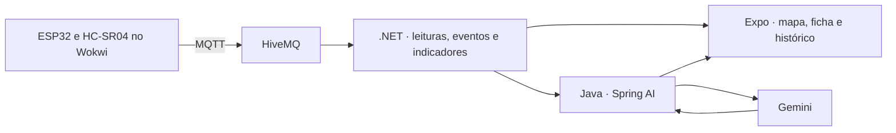

# Saneia IoT

O Saneia monitora o nível de reservatórios simulados. Um ESP32 lê a distância até a superfície com o HC-SR04 e publica a medição no HiveMQ. O .NET converte a distância em volume, guarda o histórico e calcula os estados. O Java consulta os indicadores do mesmo histórico e usa Spring AI com Gemini para redigir o insight que a operadora vê no app.



| Pasta | Conteúdo |
| --- | --- |
| [`Arduino/`](Arduino/Saneia/) | Firmware ESP32, circuito Wokwi e dependência PubSubClient. |
| [`LLM/`](LLM/) | Ponte local em Node.js, cliente Gemini, publicador de teste MQTT e testes. |

## Arduino no Wokwi

1. Crie um projeto **Arduino com ESP32** no Wokwi. [Abrir o modelo ESP32](https://wokwi.com/projects/new/esp32)
2. Copie [`Saneia.ino`](Arduino/Saneia/Saneia.ino) para o arquivo `sketch.ino` do editor. Substitua o `diagram.json` pelo [circuito do projeto](Arduino/Saneia/diagram.json) e adicione `PubSubClient` no gerenciador de bibliotecas. A pasta contém o [`libraries.txt`](Arduino/Saneia/libraries.txt) correspondente.
3. Inicie a simulação. O monitor serial registra **Conectado ao HiveMQ** e mostra uma amostra a cada cinco segundos. Clique no HC-SR04 para mudar a distância.

O sketch usa `Wokwi-GUEST`, GPIO 5 para `TRIG` e GPIO 18 para `ECHO`. Para a demonstração, ele publica mensagens fictícias no broker público `broker.hivemq.com:1883`, no tópico `saneia/demo/72f4a1ce9b/res07/telemetry`, com QoS 0. O `sensorId` do firmware é `S07`, associado ao equipamento `RES-07` do catálogo Java. Cada reinício gera um prefixo aleatório para o identificador da amostra.

```json
{
  "schemaVersion": 1,
  "sensorId": "S07",
  "sampleId": "abcd0123abcd0123-1",
  "distanceCm": 17
}
```

A calibração de teste usa 202 cm como distância do tanque vazio e 200 cm de altura útil. Com capacidade de 2.000 L, o volume é a fração preenchida multiplicada pela capacidade. O limite operacional é 1.800 L.

| Distância | Volume aproximado | Estado no .NET |
| --- | ---: | --- |
| 102 cm | 1.000 L | OK |
| 42 cm | 1.600 L | Alerta |
| 17 cm | 1.850 L | Alarme |
| 102 cm em duas leituras consecutivas | 1.000 L | Alarme encerrado |

## Executar com o aplicativo

Use JDK 21 no Java, SDK .NET 8 no monitoramento e Node.js 22.13 ou superior no Expo. O catálogo local já inclui o `RES-07`.

1. Inicie a API Java na porta 8080. Configure `DOTNET_TELEMETRY_URL=http://localhost:5085/api` para consultar o histórico .NET. Para a geração com Gemini, configure `GEMINI_API_KEY` e `AI_MODEL=gemini-3.5-flash` no processo Java. [Configuração do Java](https://github.com/2TDSPO-JPG/API-Java-Global-Solutions#telemetria-net-nos-insights)
2. Inicie a API .NET na porta 5085 com `Mqtt__Enabled=true`, `Java__BaseUrl` apontando para a base Java e `Jwt__SharedSecret` igual ao `JWT_SECRET` do Java. Use a mesma `SANEIA_INTEGRATION_KEY` nos dois servidores para as chamadas internas. [Configuração do .NET](https://github.com/2TDSPO-JPG/API-DotNet-Global-Solutions#wokwi-hivemq-e-análise-do-java)
3. Rode o Expo e entre com o perfil de operadora. Abra **Mapa → RES-07** e ajuste o sensor no Wokwi. A ficha consulta o .NET a cada cinco segundos. Use as URLs indicadas no README do mobile para abrir o app no Expo Go. [Configuração do aplicativo](https://github.com/2TDSPO-JPG/SaneiaMobile#testar-wokwi-e-análise-com-o-mesmo-histórico)
4. Na ficha, escolha o período e toque em **Gerar análise com IA**. O app chama `POST /api/sensors/{id}/insights` no Java. A origem `telemetrySource: "dotnet"` identifica o histórico analisado e `aiGenerated` indica se o texto veio do Gemini. O Java pode entregar um resumo calculado quando o provedor estiver indisponível.

O backend calcula os volumes, os indicadores e os alarmes. O Gemini recebe somente os indicadores do período e redige a explicação. A chave fica no servidor. [Modelo Gemini 3.5 Flash](https://ai.google.dev/gemini-api/docs/models/gemini-3.5-flash)

## RAG na ficha do equipamento

A análise combina a telemetria do .NET com os [procedimentos simulados SAN-01 a SAN-05](LLM/knowledge/procedimentos.json). A base foi escrita para o protótipo e cobre alarme, tendência de elevação, perda de comunicação, poucas amostras e rotina. O serviço classifica os indicadores por sinais, atribui escores aos documentos e envia os dois trechos mais relevantes ao Gemini. A escolha por sinais é reproduzível e adequada a uma base pequena e a estados conhecidos.

1. Em `LLM/.env`, configure `GEMINI_API_KEY` com a chave real e `RAG_INTEGRATION_TOKEN` com um token aleatório de pelo menos 32 bytes. Configure as variáveis exclusivamente nos servidores.
2. Rode `npm.cmd ci` e `npm.cmd run rag` em `LLM/`. O serviço responde em `127.0.0.1:8091` por padrão.
3. Na configuração existente do processo Java, defina `AI_BASE_URL=http://127.0.0.1:8091`, `AI_MODEL=gemini-3.5-flash` e `GEMINI_API_KEY` com o **valor de `RAG_INTEGRATION_TOKEN`**. Se o Java estiver em outro host, configure o endereço do RAG acessível ao servidor por rede privada ou HTTPS. O serviço usa a interface compatível com OpenAI. [API Gemini compatível com OpenAI](https://ai.google.dev/gemini-api/docs/openai)
4. Gere um insight no app. Confira `telemetrySource: "dotnet"`, `aiGenerated: true`, números iguais à telemetria e a referência `[SAN-01]` ao mencionar o procedimento de alarme. O Java mantém o resumo calculado quando a geração falha.

As chamadas do Spring AI para outras funcionalidades seguem para o Gemini com o prompt original. A busca de procedimentos enriquece os insights de equipamento. A ponte da seção seguinte também usa a mesma base. Os procedimentos são referências acadêmicas de triagem, com cobertura restrita aos cinco cenários. As fontes recuperadas podem ser verificadas pelo ID, e métricas e alarmes seguem a lógica da telemetria.

### Evidências de avaliação

| Cenário | Critério verificado pela suíte |
| --- | --- |
| Alarme com pico de 1.850 L | Seleciona SAN-01, preserva os números recebidos e entrega o trecho ao provedor. |
| Falha de comunicação com alarme anterior | Prioriza SAN-03 e inclui SAN-01 como contexto histórico. |
| Alerta, poucas leituras e rotina | Seleciona SAN-02, SAN-04 ou SAN-05 conforme os sinais. |
| Credencial ausente, corpo inválido ou provedor indisponível | Responde com erro controlado. |

Os testes automatizados verificam a recuperação e o contrato com um provedor simulado. Para o vídeo ou a avaliação presencial, execute o cenário de alarme com sua chave real e confira se o texto preserva as métricas e cita somente as referências recuperadas.

### Integrantes

| Nome | RM |
| --- | --- |
| Pedro Ferreira | RM565824 |
| Jonas Santos | RM563234 |
| Gabriel Muller | RM561995 |

## Rodar o LLM localmente

A ponte em `LLM/` permite acompanhar o MQTT e testar a análise com Node.js. Ela guarda as amostras em `LLM/data/telemetry.json` por padrão. Use Node.js 22.13 ou superior.

```powershell
cd LLM
npm.cmd ci
Copy-Item .env.example .env
npm.cmd start
```

Para habilitar a análise, inicie a ponte com `./iniciar.ps1 -Gemini` e digite a chave no prompt oculto. Também é possível configurar `GEMINI_API_KEY` no `.env` local. O modelo é selecionado por `GEMINI_MODEL`. O Git ignora o `.env` e os dados coletados.

Com a ponte rodando, publique pelo Wokwi ou use o publicador Node em outro terminal na pasta `LLM`. O publicador Node aguarda a confirmação do broker com QoS 1. Use uma fonte de leitura por vez para o mesmo equipamento.

```powershell
npm.cmd run simular -- 102 42 17 17 102 102 102
```

| Método e rota | Retorno na porta 8090 |
| --- | --- |
| `GET /health` | Conexão MQTT, disponibilidade da chave e estado atual. |
| `GET /sensors` | Resumo do equipamento simulado. |
| `GET /sensors/S07` | Ficha, amostras e eventos. |
| `POST /sensors/S07/insights` | Resumo do Gemini para o intervalo solicitado. |

```powershell
Invoke-RestMethod http://127.0.0.1:8090/health
Invoke-RestMethod http://127.0.0.1:8090/sensors/S07
$periodo = @{ period = "all"; to = [DateTime]::UtcNow.ToString("o") } | ConvertTo-Json
Invoke-RestMethod http://127.0.0.1:8090/sensors/S07/insights `
  -Method Post -ContentType "application/json" -Body $periodo
```

A ponte local encerra o alarme após três medições abaixo de 1.750 L e marca o ponto sem comunicação após 25 segundos sem amostras novas. Com `IOT_DEMO_TOKEN` configurado, envie o cabeçalho `Authorization: Bearer <token>` nas consultas. Use `MQTT_URL` e `MQTT_TOPIC` para apontar para um broker e tópico de teste próprios.

## Testes

Execute `npm.cmd test` em `LLM/`. A suíte verifica o formato da mensagem MQTT, a conversão da distância, a repetição de uma amostra, os estados de alarme e recuperação e o contrato do cliente Gemini com respostas simuladas.

Para compilar o firmware fora do Wokwi, rode os comandos abaixo na raiz do repositório com a Arduino CLI instalada. [Instalação da Arduino CLI](https://arduino.github.io/arduino-cli/latest/installation/) · [Suporte ESP32](https://docs.espressif.com/projects/arduino-esp32/en/latest/installing.html)

```powershell
$index = 'https://espressif.github.io/arduino-esp32/package_esp32_index.json'
arduino-cli core update-index --additional-urls $index
arduino-cli core install esp32:esp32@2.0.17 --additional-urls $index
arduino-cli lib install PubSubClient@2.8
arduino-cli compile --fqbn esp32:esp32:esp32 Arduino/Saneia
```
